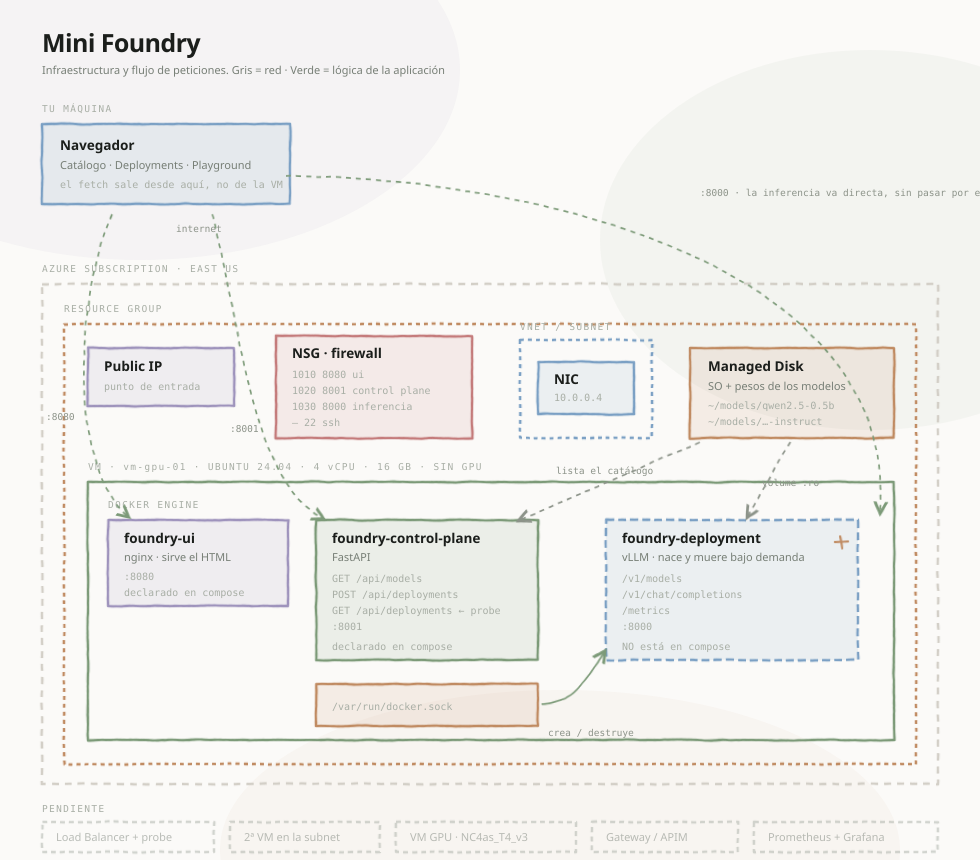
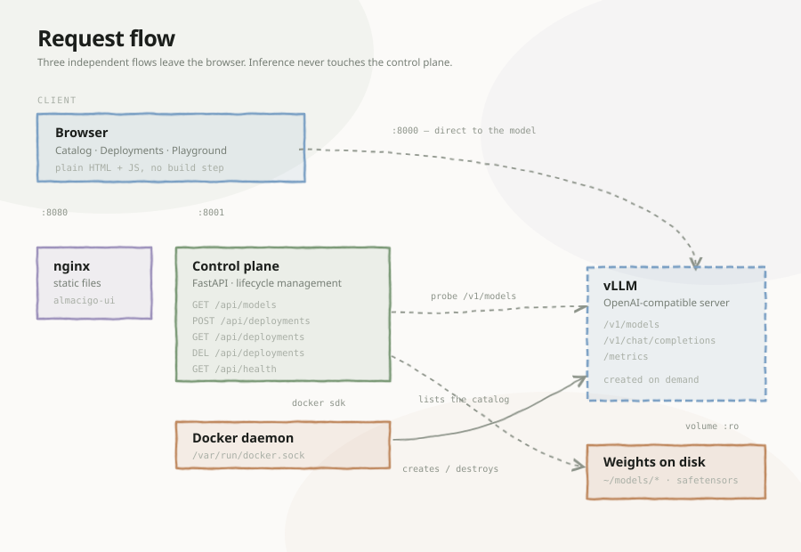

# Almácigo

> *Almácigo* — the seedbed where plants germinate before being transplanted.

A hand-built inference control plane for LLMs, assembled piece by piece to
understand what actually sits inside platforms like Azure AI Foundry, AWS
Bedrock, or Together AI.

This is not a product. It's a lab: every component is deliberately reduced to
its smallest useful form so it can be read, broken, and rebuilt in an afternoon.



---

## What it does

- **Catalog** — discovers models on disk and detects whether each one is a base
  or instruct model by reading its `config.json`
- **Deployments** — creates and destroys vLLM containers on demand, with real
  lifecycle state (`provisioning` → `running` → `failed`)
- **Playground** — token-by-token streaming chat, measuring TTFT and tokens/sec

All on a single VM, no GPU, behind an OpenAI-compatible API.

---

## Why it exists

When a company buys hardware to run models internally, they hit a wall. The gap
between *"I have a machine"* and *"my developers have an endpoint"* involves a
pile of work that no documentation explains well.

This repo walks that gap on foot. The goal isn't to automate anything — it's to
keep every layer visible:

| Concept | Where you see it |
|---|---|
| A deployment is an object with state | `control-plane/main.py` → `get_deployment()` |
| `running` ≠ `ready` | the probe to `/v1/models` before declaring a deployment live |
| Cold start | first request takes minutes, the second takes seconds |
| Why SFT exists | deploy the base model and ask it anything |
| Streaming is perception, not speed | total time is unchanged, first token isn't |

---

## Architecture

Three containers, but only two declared:

```
almacigo-ui              nginx, serves the HTML         :8080   ← compose
almacigo-control-plane   FastAPI, manages deployments   :8001   ← compose
almacigo-deployment      vLLM, serves the model         :8000   ← created at runtime
```

See it yourself:

```bash
docker ps            # shows three
docker compose ps    # shows two
```

That discrepancy *is* the architecture. Compose declares static infrastructure;
the control plane manages dynamic resources by talking to `/var/run/docker.sock`.

**Inference does not go through the control plane.** The browser calls `:8001`
to manage and `:8000` to generate. That's why both ports must be open, and why a
gateway would sit in front of `:8000`, not `:8001`.



---

## Requirements

- A Linux VM with Docker and Docker Compose
- 16 GB RAM (enough for models up to ~1B in `float32`)
- AVX-512 recommended — check with `lscpu | grep avx512`
- No GPU. That's intentional: almost everything here is learned the same way,
  at a fraction of the cost

---

## Getting started

**1. Download a model**

```bash
mkdir -p ~/models && cd ~/models
pip install huggingface_hub
hf download Qwen/Qwen2.5-0.5B-Instruct --local-dir qwen2.5-0.5b-instruct
```

Download the **base** model too (`Qwen/Qwen2.5-0.5B`, without `-Instruct`).
Having both enables the most instructive experiment in this repo.

**2. Bring it up**

```bash
git clone https://github.com/Josoriop9/Almacigo.git almacigo
cd almacigo
docker compose up -d --build
```

> The directory name matters: Compose derives the Docker network name from it,
> and the control plane expects `almacigo_default`.

**3. Verify**

```bash
curl -s http://localhost:8001/api/health
curl -s http://localhost:8001/api/models
```

**4. Open the ports**

On a cloud provider, open `8080`, `8001`, and `8000` to your IP.
On Azure: VM → Networking → Add inbound port rule, with **Source: My IP address**.

**5. Open it**

`http://<your-ip>:8080`

---

## The experiment worth running

Deploy `qwen2.5-0.5b` (the base model) and ask it `What is 2+2?`:

```
embourgsystem-25
foy eazyway system
```

Now deploy `qwen2.5-0.5b-instruct` and ask the same thing:

```
The answer to 2+2 is 4.
```

Same size. Same 494M parameters. Same infrastructure. The only difference is
that the second one went through supervised fine-tuning.

Pretraining gives a model language. SFT gives it the ability to answer. Very few
people get to see that difference with their own hands.

---

## Baseline measurements

Qwen2.5-0.5B-Instruct · 4 vCPU · no GPU · `float32`

| | |
|---|---|
| Cold start (first request) | ~190 s |
| Steady state, 30 tokens | ~6 s |
| Throughput | ~5 tok/s |

Painfully slow, and that's the point: these are the numbers to compare against
once a GPU shows up.

---

## Decisions, and why

**CPU before GPU.** Of the steps that make up this lab, very few actually need a
GPU. Load balancing, gateway, control plane, and UI are learned identically on a
cheap VM. The GPU comes last, to measure the contrast.

**Use `vllm-openai-cpu`, not `vllm-openai`.** Forcing the CUDA image onto CPU
with `VLLM_TARGET_DEVICE=cpu` fails with
`AttributeError: '_OpNamespace' '_C' object has no attribute 'init_cpu_memory_env'`.
The CPU-compiled operators simply aren't in that image. There's a separate image,
with the arch in the tag: `vllm/vllm-openai-cpu:latest-x86_64`.

**`--gpu-memory-utilization` on CPU.** Yes, the flag is named that even with no
GPU present. On the CPU backend it controls the fraction of system RAM reserved.
Inherited name.

**One deployment at a time.** Two `float32` models won't fit in 16 GB. Juggling
memory across several would be a distraction; the lifecycle is just as clear with
one.

**Docker socket mounted into the control plane.** This is equivalent to granting
root on the host. Acceptable in a lab, never in production. A real system would
use a runtime with scoped permissions.

---

## Roadmap

- [ ] Load balancer with health probe + second VM
- [ ] Gateway (nginx or APIM) with auth and rate limiting
- [ ] GPU T4: drivers, CUDA, and a performance comparison
- [ ] Prometheus + Grafana on vLLM's `/metrics`
- [ ] Agent loop and eval suite
- [ ] Tests and CI

---

## Cleanup

The VM bills while it runs. Stop it from your provider's console, not with
`shutdown` from inside — shutting down the OS does not release the compute.

```bash
az vm deallocate --name <vm> --resource-group <rg>
```

To remove everything, delete the resource group.

---

## License

